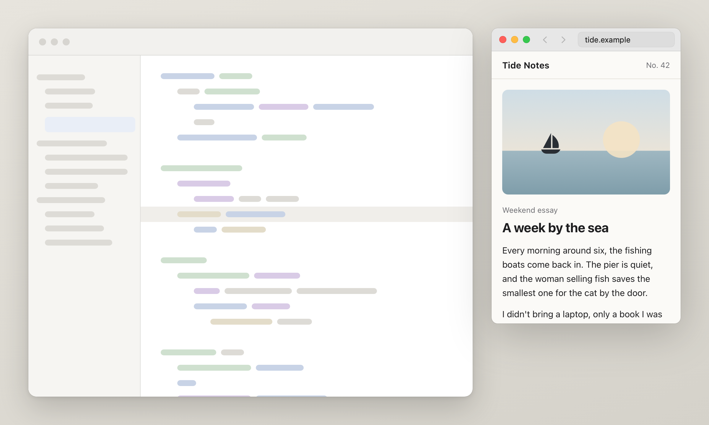

# MiniBrowser

[中文](README.md) · English · [Website](https://zhiyozhao.github.io/MiniBrowser/en/)

A macOS browser that can shrink to a very small window, kept apart from the browser you normally use.<br>
Leave a page open in a corner of the screen and keep working.

<picture>
  <source media="(prefers-color-scheme: dark)" srcset="docs/assets/hero-en-dark.png">
  
</picture>

```bash
brew install --cask zhiyozhao/tap/minibrowser
```

Requires macOS 13 or later. Without Homebrew, download the DMG from [Releases](https://github.com/zhiyozhao/MiniBrowser/releases/latest) and drag MiniBrowser into Applications.

## Why it exists

When you want a page to stay within reach while you work, like an article you haven't finished, a live stream, or a web chat, the easiest thing is a small window in a corner. MiniBrowser does only that.

- **The window can be very small.** The minimum is 228 × 360 pt. As the window narrows, the new tab, reload, forward and back buttons fold away in that order. The address bar always stays.
- **Separate from your everyday browser.** It is its own app, and its cookies, cache and sign-ins live only in its own folders. It can't see the history, tabs or accounts in Safari or Chrome, and the pages it opens don't show up there.
- **One row of interface.** Window buttons, a few controls and the address bar. No bookmarks bar, sidebar or settings page. The tab bar appears only when a second tab is open.

<picture>
  <source media="(prefers-color-scheme: dark)" srcset="docs/assets/widths-en-dark.png">
  
</picture>

## Using it

The toolbar is icons only. The menus and the few labels in the app are in Chinese.

**Address bar**: addresses starting with `http://` or `https://` open directly. Text without spaces that contains a dot (such as `example.com`) opens with `https://` added. Anything else is searched on Bing. A new tab puts the cursor in the address bar.

**Windows**: drag the empty area at the top to move a window. Every new window opens at 1100 × 700 in the middle of the screen; drag it smaller from there. MiniBrowser quits when its last window closes.

**Zoom**: `⌘ -` / `⌘ =` change zoom by 10% between 50% and 200%, remembered per site (`www.` is treated as the same site). Trackpad pinch zoom also works but isn't remembered.

**Pop-ups**: windows a page opens (sign-in, payment, `target="_blank"` links) open as separate small windows and share the sign-in state of the original page.

| Shortcut | Action |
| --- | --- |
| `⌘ T` | New tab |
| `⌘ W` | Close tab; closes the window if it's the last tab |
| `⌘ N` | New window |
| `⌘ [` / `⌘ ]` | Back / Forward |
| `⌘ R` | Reload; stops loading if a page is loading |
| `⌘ -` / `⌘ =` / `⌘ 0` | Zoom out / Zoom in / Back to 100% |
| `⌘ Q` | Quit |

Shortcuts keep working after their buttons fold away in a narrow window.

## Where data is stored

MiniBrowser uses its own WebKit data folders and shares nothing with other browsers:

| What | Where |
| --- | --- |
| Website data (local storage and so on) | `~/Library/WebKit/com.zhao.minibrowser` |
| Cookies | `~/Library/HTTPStorages/com.zhao.minibrowser.binarycookies` |
| Cache | `~/Library/Caches/com.zhao.minibrowser` |
| Per-site zoom levels | `~/Library/Preferences/com.zhao.minibrowser.plist` |

MiniBrowser has no accounts, analytics or update checks, and collects no usage data. When what you type in the address bar isn't an address, it is sent to Bing as a search.

If a site's certificate is invalid, MiniBrowser shows an explanation page, and you can click "仍然继续" (Continue anyway) if you trust the site. The exception applies only to that site for the current run and is kept only in memory. Camera and microphone requests from websites are always denied.

## FAQ

**Can it download or upload files?**
No, on purpose. Downloads, uploads, opening other apps (links like `mailto:` or `weixin:`), camera and microphone are all left out. Clicking a download link leaves you on the current page and nothing is downloaded.

**Some sites won't let me sign in?**
MiniBrowser doesn't support passkeys. Nested sign-ins that rely on third-party cookies and some card verification pages may also fail; this is a WKWebView limitation.

**macOS says it can't verify the developer when I open the app from the DMG?**
MiniBrowser isn't notarized by Apple. Open it once, then go to System Settings → Privacy & Security and click "Open Anyway" near the bottom. Installing with Homebrew avoids this prompt.

**How do I uninstall it?**
`brew uninstall --cask --zap minibrowser` removes the app and its preferences. If you installed it by hand, drag MiniBrowser to the Trash. Website data, cookies and cache need to be removed by hand from the locations in the table above.

## License

[MIT](LICENSE) · [Changelog](CHANGELOG.md) · [Development notes](docs/DEVELOPMENT.md)
