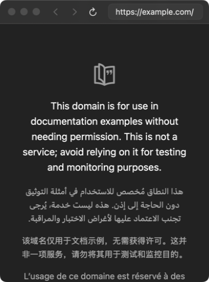
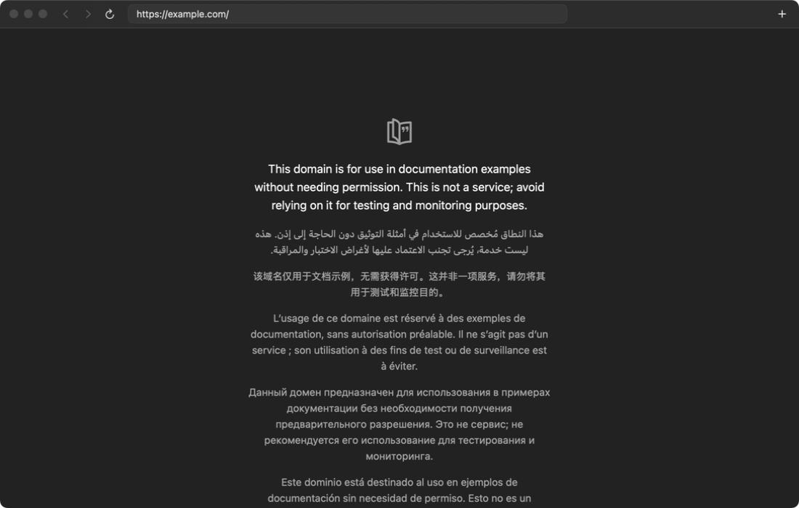

# MiniBrowser

[中文](README.md) | English

A tiny, independent browser window. Keep it in a corner of your screen to open a page on the side, out of the way of the browser you normally use.

[](https://github.com/zhiyozhao/MiniBrowser/releases/latest)




```bash
brew install --cask zhiyozhao/tap/minibrowser
```

Not using Homebrew? Download the DMG from [Releases](https://github.com/zhiyozhao/MiniBrowser/releases/latest) and drag MiniBrowser into Applications. Requires macOS 13 or later.

## Highlights

- **The window can be really small.** Shrink it down to 228×360; as it narrows, buttons step out of the way one by one and the address bar stays usable.
- **Separate from your everyday browser.** Its own windows, cookies and cache — it never reads or shares anything with Safari or Chrome. Park it on the side without interfering with anything.
- **Never gets in your way.** No notifications, no accounts, no push, and no camera or microphone permission requests.
- Pop-up windows on the web (sign-in, payment) open properly, and your login state is kept.
- Web alert / confirm / prompt dialogs work as expected; on certificate errors you can choose to continue.
- Crashed pages reload automatically; the zoom level of each site is remembered.

## How to use



**Shortcuts**

| Shortcut | Action |
| --- | --- |
| `Command + T` | New tab |
| `Command + W` | Close tab (closes the window when it is the only tab) |
| `Command + N` | New window |
| `Command + [` / `Command + ]` | Back / forward |
| `Command + R` | Reload (stop while loading) |
| `Command + -` / `Command + =` / `Command + 0` | Zoom out / zoom in / actual size |
| `Command + Q` | Quit |

**Address bar**: type a URL to open it, or type anything else to search with Bing. New tabs focus the address bar automatically, so you can type right away.

**Windows**: shrink them as far as you like (down to 228×360); drag the window by any empty spot in the top bar. Window size and position are remembered. The tab bar only shows up when you have more than one tab — otherwise there is just the address bar. Pages themselves support trackpad pinch zoom, with zoom remembered per site.

## Privacy

- MiniBrowser itself does no networking: apart from the pages you open loading their own content, there is no telemetry, analytics or account system.
- Everything stays on your machine: cookies and cache live in `~/Library/WebKit/com.zhao.minibrowser`, and settings (per-site zoom, window position) in `~/Library/Preferences/com.zhao.minibrowser.plist`.
- Fully isolated from other browsers: it never reads history, cookies or passwords from Safari or Chrome, and your login state here never leaks out.
- The exception behind "continue anyway" on certificate errors is kept in memory only. Quitting MiniBrowser forgets it; nothing is written to disk.
- Camera and microphone requests from websites are always denied outright — no prompt, no remembered choice.

## FAQ

**Why can't I download or upload files?**
By design. MiniBrowser is a minimal small-window browser, not a full browser; downloads, file uploads, jumping to external apps, and camera/microphone access are all deliberately left out. When you hit a download link, MiniBrowser stays on the current page.

**Nothing happens when I tap "Open in WeChat" or "Send email"?**
Also by design. MiniBrowser never hands links over to other apps; such links are simply ignored.

**What if a site shows a certificate error?**
MiniBrowser shows an error page. If you trust the site, click "Continue anyway". The exception applies only to that site for the current run — quitting MiniBrowser asks you again.

**macOS says the app "cannot be verified by Apple" when I open it from the DMG?**
The app is not notarized. On macOS 15, double-click it once, then go to System Settings → Privacy & Security and click "Open Anyway" at the bottom; on macOS 14 you can also right-click the app in Finder and choose Open. Installing via Homebrew handles the download quarantine automatically and skips this.

**How do I uninstall?**
Run `brew uninstall --cask --zap minibrowser` to remove preferences as well, or drag MiniBrowser from Applications to the Trash. To remove every trace, also delete `~/Library/WebKit/com.zhao.minibrowser` and `~/Library/Preferences/com.zhao.minibrowser.plist`.

## License

[MIT](LICENSE)

---

[Changelog](CHANGELOG.md) · [Development docs](docs/DEVELOPMENT.md)
