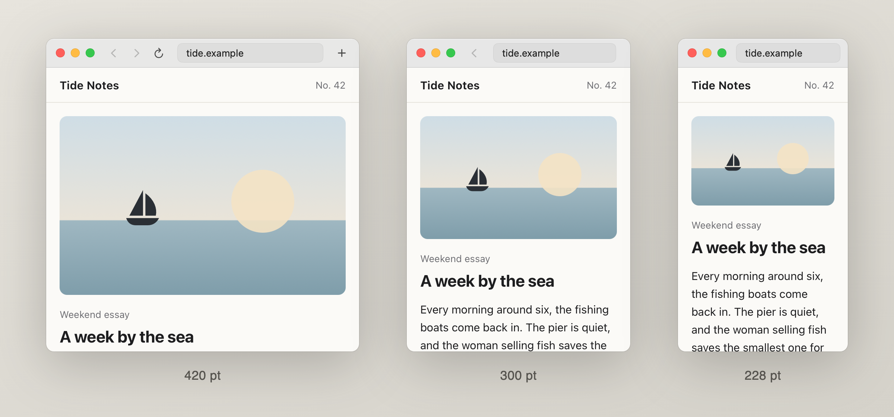

# MiniBrowser

[中文](README.md) · English · [Website](https://zhiyozhao.github.io/MiniBrowser/en/)

A macOS browser that can shrink to a very small window, kept apart from the browser you normally use.<br>
Leave a page open in a corner of the screen and keep working.

<picture>
  <source media="(prefers-color-scheme: dark)" srcset="docs/assets/hero-en-dark.png">
  
</picture>

## Install

```bash
brew install --cask zhiyozhao/tap/minibrowser
```

Or download the DMG from [Releases](https://github.com/zhiyozhao/MiniBrowser/releases/latest) and drag MiniBrowser into Applications. Requires macOS 13 or later. The menus are in Chinese; the toolbar is icons only.

If you install from the DMG, macOS says it can't verify the developer the first time you open it, because the app isn't notarized by Apple. Open it once, then go to System Settings → Privacy & Security and click "Open Anyway" near the bottom. Installing with Homebrew avoids this.

## How it differs from a normal browser

- **The window shrinks to 228 × 360 pt.** The narrower it gets, the fewer buttons it shows, down to just the address bar. Shortcuts still work for the buttons that fold away.
- **Fully separate from your other browsers.** Its cookies, cache and sign-ins are its own. It can't see your accounts or history in Safari or Chrome, and pages opened here don't show up there. No accounts, no analytics.

<picture>
  <source media="(prefers-color-scheme: dark)" srcset="docs/assets/widths-en-dark.png">
  
</picture>

## Shortcuts

| Shortcut | Action |
| --- | --- |
| `⌘ T` | New tab |
| `⌘ W` | Close tab |
| `⌘ N` | New window |
| `⌘ [` / `⌘ ]` | Back / Forward |
| `⌘ R` | Reload |
| `⌘ -` / `⌘ =` / `⌘ 0` | Zoom out / Zoom in / Actual size |

## Left out on purpose

Downloads, file uploads, opening other apps (such as `mailto:` links), camera and microphone, bookmarks and history. MiniBrowser isn't meant to be a full browser; clicking a download link does nothing.

## FAQ

**Does it remember the window size?**
No. Every new window opens at 1100 × 700, so you drag it smaller again.

**Some sites won't let me sign in?**
MiniBrowser doesn't support passkeys, and sign-ins that rely on third-party cookies may fail.

**How do I uninstall it?**
`brew uninstall --cask --zap minibrowser` removes the app along with its website data, cookies, cache and settings.

---

[MIT License](LICENSE) · [Changelog](CHANGELOG.md) · [Development notes](docs/DEVELOPMENT.md)
