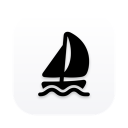

<p align="right"><b>中文</b> · <a href="README.en.md">English</a></p>

<p align="center">
  
</p>

<h1 align="center">MiniBrowser</h1>

<p align="center">
  能缩得很小的 macOS 浏览器，放在屏幕一角开着一个网页。
</p>

<p align="center">
  <a href="#安装"><b>安装</b></a> · <a href="https://zhiyozhao.github.io/MiniBrowser/">官网</a>
</p>

<picture>
  <source media="(prefers-color-scheme: dark)" srcset="docs/assets/hero-zh-dark.png">
  
</picture>

## 安装

需要 macOS 13 或更新版本。

### 用 Homebrew

```bash
brew install --cask zhiyozhao/tap/minibrowser
```

### 手动安装

1. 从 [Releases](https://github.com/zhiyozhao/MiniBrowser/releases/latest) 下载 DMG。
2. 打开 DMG，把 MiniBrowser 拖进“应用程序”。
3. 第一次打开时如果提示“无法验证开发者”，先关掉提示，到“系统设置 → 隐私与安全性”，在页面底部点“仍要打开”。

## 特点

- **缩到多窄都能用。** 越窄按钮越少，最窄时只剩地址栏。
- **自己的一套登录和数据。** 在这里登录的账号和 Cookie 只属于 MiniBrowser，和你每天用的浏览器互不影响。

<picture>
  <source media="(prefers-color-scheme: dark)" srcset="docs/assets/widths-zh-dark.png">
  
</picture>

## 快捷键

| 快捷键 | 作用 |
| --- | --- |
| `⌘ T` | 新建标签页 |
| `⌘ W` | 关闭标签页 |
| `⌘ N` | 新建窗口 |
| `⌘ [` / `⌘ ]` | 后退 / 前进 |
| `⌘ R` | 刷新 |
| `⌘ -` / `⌘ =` / `⌘ 0` | 缩小 / 放大 / 恢复原始大小 |

窗口太窄、按钮被收起时，快捷键照样能用。

## 不支持

下载和上传文件、打开其他 app 的链接、摄像头和麦克风、书签、历史记录。

## 常见问题

### 窗口大小会被记住吗？

不会。`⌘ N` 新建的窗口都是 1100 × 700。

### 有些网站登录不上？

部分登录方式用不了，比如通行密钥（Passkey）。

### 怎么卸载？

`brew uninstall --cask --zap minibrowser`，会一起删掉网站数据和设置。手动安装的，把 MiniBrowser 拖到废纸篓。

---

[MIT 许可证](LICENSE) · [更新记录](CHANGELOG.md)
