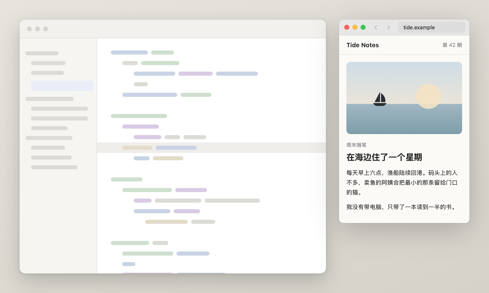

# MiniBrowser

中文 · [English](README.en.md) · [官网](https://zhiyozhao.github.io/MiniBrowser/)

一个能缩得很小的 macOS 浏览器，和你平时用的浏览器分开。<br>
把它放在屏幕一角开着一个网页，手上的事照常做。

<picture>
  <source media="(prefers-color-scheme: dark)" srcset="docs/assets/hero-zh-dark.png">
  
</picture>

```bash
brew install --cask zhiyozhao/tap/minibrowser
```

需要 macOS 13 或更新版本。不用 Homebrew 的话，从 [Releases](https://github.com/zhiyozhao/MiniBrowser/releases/latest) 下载 DMG，把 MiniBrowser 拖进“应用程序”。

## 为什么是它

想在工作时让一个网页留在手边，比如一篇没读完的文章、一场直播、一个网页版聊天，最顺手的办法是开一个小窗口放在角落。MiniBrowser 只做这件事。

- **窗口可以很小。** 最小 228 × 360 pt。窗口变窄时，新建标签、刷新、前进、后退按钮依次收起，地址栏一直都在。
- **和日常浏览器分开。** 它是单独的一个 app，Cookie、缓存和登录状态只存在它自己的目录里。Safari、Chrome 里的历史、标签和账号它都看不到，它打开过的页面也不会出现在那边。
- **界面只有一行。** 红绿灯、几个按钮和地址栏，没有书签栏、侧边栏和设置页。开了第二个标签才出现标签栏。

<picture>
  <source media="(prefers-color-scheme: dark)" srcset="docs/assets/widths-zh-dark.png">
  
</picture>

## 使用

**地址栏**：输入以 `http://` 或 `https://` 开头的网址直接打开；不带空格、带点的内容（如 `example.com`）会补上 `https://` 打开；其他内容用 Bing 搜索。新标签页会自动聚焦地址栏。

**窗口**：拖动顶部的空白处可以移动窗口。每个新窗口都以 1100 × 700 打开在屏幕中央，需要的话再拖小。最后一个窗口关闭后，MiniBrowser 随之退出。

**缩放**：`⌘ -` / `⌘ =` 每次调整 10%，范围 50% 到 200%，按网站分别记住（`www.` 前缀视为同一网站）。触控板双指缩放也可以用，但不会被记住。

**弹出窗口**：网页打开的新窗口（登录、支付、`target="_blank"` 链接）会以单独的小窗口打开，和原页面共用登录状态。

| 快捷键 | 作用 |
| --- | --- |
| `⌘ T` | 新建标签页 |
| `⌘ W` | 关闭标签页；只剩一个时关闭窗口 |
| `⌘ N` | 新建窗口 |
| `⌘ [` / `⌘ ]` | 后退 / 前进 |
| `⌘ R` | 刷新；加载中按下为停止 |
| `⌘ -` / `⌘ =` / `⌘ 0` | 缩小 / 放大 / 恢复 100% |
| `⌘ Q` | 退出 |

窗口窄到按钮被收起后，对应的快捷键仍然可用。

## 数据存在哪里

MiniBrowser 使用自己的 WebKit 数据目录，和其他浏览器互不共享：

| 内容 | 位置 |
| --- | --- |
| 网站数据（本地存储等） | `~/Library/WebKit/com.zhao.minibrowser` |
| Cookie | `~/Library/HTTPStorages/com.zhao.minibrowser.binarycookies` |
| 缓存 | `~/Library/Caches/com.zhao.minibrowser` |
| 各网站的缩放比例 | `~/Library/Preferences/com.zhao.minibrowser.plist` |

MiniBrowser 没有账号、统计和更新检查，不收集任何使用数据。地址栏里输入的不是网址时，内容会发给 Bing 搜索。

网站证书无效时，MiniBrowser 显示一个说明页，确认没问题可以点“仍然继续”。这个例外只对该网站、本次运行有效，只存在内存里。网站请求摄像头或麦克风时一律拒绝。

## 常见问题

**能下载文件、上传文件吗？**
不能，这是有意的。下载、上传、跳转到其他 app（如 `mailto:`、`weixin:` 链接）、摄像头和麦克风都不做。点到下载链接时页面停在原处，不会开始下载。

**有些网站登录不上？**
MiniBrowser 不支持通行密钥（Passkey）。依赖第三方 Cookie 的嵌套登录和部分银行卡验证也可能失败，这是 WKWebView 的限制。

**打开 DMG 里的 app 时提示“无法验证开发者”？**
MiniBrowser 没有经过 Apple 公证。先双击打开一次，再到“系统设置 → 隐私与安全性”底部点“仍要打开”。用 Homebrew 安装不会遇到这个提示。

**怎么卸载？**
`brew uninstall --cask --zap minibrowser` 会删除 app 和偏好设置；手动安装的话把 MiniBrowser 拖到废纸篓。网站数据、Cookie 和缓存需要手动删除上表中的几个位置。

## 许可证

[MIT](LICENSE) · [更新记录](CHANGELOG.md) · [开发文档](docs/DEVELOPMENT.md)
