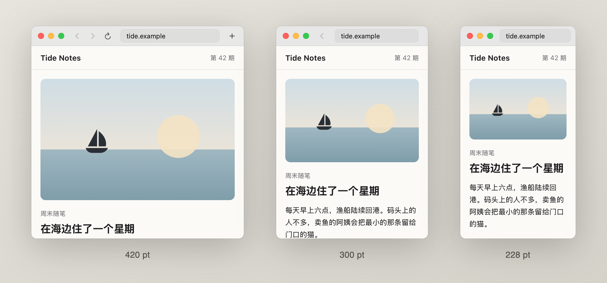

# MiniBrowser

中文 · [English](README.en.md) · [官网](https://zhiyozhao.github.io/MiniBrowser/)

一个能缩得很小的 macOS 浏览器，和你平时用的浏览器分开。<br>
把它放在屏幕一角开着一个网页，手上的事照常做。

<picture>
  <source media="(prefers-color-scheme: dark)" srcset="docs/assets/hero-zh-dark.png">
  
</picture>

## 安装

```bash
brew install --cask zhiyozhao/tap/minibrowser
```

也可以从 [Releases](https://github.com/zhiyozhao/MiniBrowser/releases/latest) 下载 DMG，把 MiniBrowser 拖进“应用程序”。需要 macOS 13 或更新版本。

用 DMG 安装的话，第一次打开会提示“无法验证开发者”，因为 app 没有经过 Apple 公证。先双击打开一次，再到“系统设置 → 隐私与安全性”底部点“仍要打开”。Homebrew 安装不会遇到这个提示。

## 和普通浏览器的不同

- **窗口能缩到 228 × 360 pt。** 越窄按钮越少，最后只剩地址栏；收起的按钮，快捷键照样能用。
- **和其他浏览器完全隔离。** Cookie、缓存和登录状态都是它自己的。Safari、Chrome 里的账号和历史在这里看不到，这里打开的页面也不会出现在那边。没有账号，也没有统计。

<picture>
  <source media="(prefers-color-scheme: dark)" srcset="docs/assets/widths-zh-dark.png">
  
</picture>

## 快捷键

| 快捷键 | 作用 |
| --- | --- |
| `⌘ T` | 新建标签页 |
| `⌘ W` | 关闭标签页 |
| `⌘ N` | 新建窗口 |
| `⌘ [` / `⌘ ]` | 后退 / 前进 |
| `⌘ R` | 刷新 |
| `⌘ -` / `⌘ =` / `⌘ 0` | 缩小 / 放大 / 恢复原始大小 |

## 有意不做

下载、上传文件、跳转到其他 app（如 `mailto:`、微信链接）、摄像头和麦克风、书签和历史记录。MiniBrowser 不打算成为完整的浏览器，点到下载链接时不会有反应。

## 常见问题

**窗口大小会被记住吗？**
不会。每个新窗口都以 1100 × 700 打开，需要再拖小。

**有些网站登录不上？**
MiniBrowser 不支持通行密钥（Passkey），依赖第三方 Cookie 的登录也可能失败。

**怎么卸载？**
```bash
brew uninstall --cask --zap minibrowser
rm -rf ~/Library/WebKit/com.zhao.minibrowser ~/Library/Caches/com.zhao.minibrowser \
       ~/Library/HTTPStorages/com.zhao.minibrowser.binarycookies
```
第二行删除网站数据、缓存和 Cookie。

---

[MIT 许可证](LICENSE) · [更新记录](CHANGELOG.md) · [开发文档](docs/DEVELOPMENT.md)
